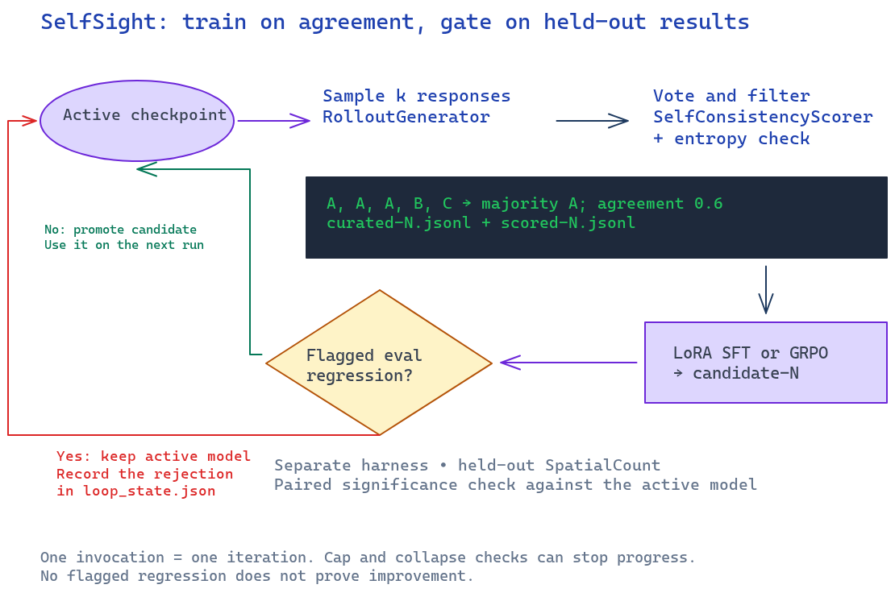
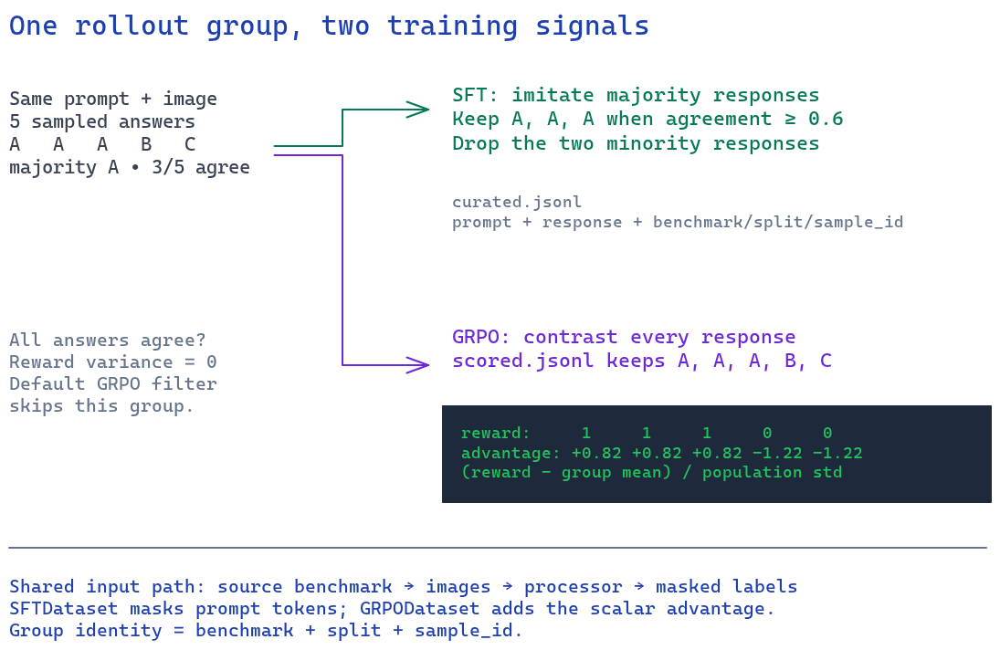

# SelfSight

Post-train vision-language models on their own responses, then check candidates
against a separate, held-out benchmark before promoting them.

SelfSight samples several answers per prompt, uses answer agreement to select
training data, and trains with LoRA SFT or an offline, group-relative reward
objective. [vlm-evaluation-harness](https://github.com/OnePunchMonk/vlm-evaluation-harness)
provides model adapters, benchmarks, and the independent regression gate.

## How it works



1. **Generate:** sample `k` responses for each training prompt.
2. **Score:** extract answers; compute majority agreement and vote entropy.
3. **Train:** use majority responses for SFT, or all informative groups for GRPO.
4. **Evaluate:** compare the candidate with the active checkpoint on a different benchmark.
5. **Promote or keep:** replace the active checkpoint only when the gate finds no flagged regression.

Agreement is a training signal, not proof of correctness. Passing the gate means
no regression was detected; it does **not** establish a capability gain.

## Quickstart

Use Python 3.10+ from the repository root:

```bash
pip install -e '.[dev,training]'
pytest tests/ -q
```

Try rollout generation with the offline mock adapter (no GPU or model download):

```bash
python -m data.cli --model mock:demo-v1 --benchmark demo_mc --k 5 \
  --min-agreement 0.4 --output curated.jsonl --scored-output scored.jsonl \
  --metrics-output metrics.jsonl
```

The mock demo uses a 0.4 agreement threshold to retain examples. Real training
recipes default to 0.6. This writes majority-selected SFT examples, all scored responses for GRPO, and
agreement/entropy history. Images are reloaded from the source benchmark at
training time rather than stored in JSONL.

## Train a model

Generate real responses by replacing `mock:demo-v1` with
`hf:OpenGVLab/InternVL3-2B-hf`. Then edit the chosen YAML's input and output paths:

```bash
# Set curated_jsonl to your generated curated.jsonl.
python -m training.cli --config configs/sft_internvl_real_demo.yaml

# Alternatively, set scored_jsonl to your generated scored.jsonl.
python -m training.grpo_cli --config configs/grpo_internvl.yaml
```

The supplied recipes use GPU training, LoRA, batch size 1, and gradient
accumulation. Larger per-device batches need a model-specific image collator.
Some recipes contain `/data` paths for Modal; change them for local runs.



GRPO rewards majority answers with 1 and other answers with 0, then normalizes
rewards within each prompt group. Unanimous groups have no relative learning
signal and are skipped by the default reward-variance filter. This implementation
trains on saved rollouts; it does not regenerate them during each optimizer step.

## Run one loop iteration

```bash
python -m training.loop_cli --config configs/loop_internvl.yaml
```

Each invocation generates data, trains one candidate, evaluates it, and saves
state. Invoke it again to continue from that state.

| Setting | Purpose |
| --- | --- |
| `train_benchmark` / `eval_benchmark` | Must name different manifests; verify their underlying samples do not overlap. |
| `training_mode` | `sft` or `grpo`; training hyperparameters come from `training_config_path`. |
| `iteration_cap` | Stops further iterations until explicitly overridden after review. |
| `metrics_path` | Records agreement and entropy; rising agreement with falling entropy can stop training. |
| `state_path` | Stores the active model, iteration count, and promotion history. |
| `regression_threshold` | Passed to the harness's paired-significance regression comparison. |

The default training path checks collapse before training. History comparisons
currently use the same model identifier and benchmark, so a newly promoted
checkpoint starts a new comparison series. This heuristic can flag legitimate
convergence and can miss other failure modes; inspect the responses and held-out
results. `--override-cap` and `--override-collapse` explicitly bypass their checks.

## Modal

The Modal app uses an L4 and a persistent `selfsight-data` volume mounted at `/data`.
Install the extra and authenticate Modal before running:

```bash
pip install -e '.[modal]'
modal run infra/modal_app.py::generate_rollouts --model mock:demo-v1 --benchmark demo_mc
modal run infra/modal_app.py::train_sft --config configs/sft_internvl_real_demo.yaml
modal run infra/modal_app.py::train_grpo --config configs/grpo_internvl.yaml
modal run infra/modal_app.py::eval_model --model hf:OpenGVLab/InternVL3-2B-hf --bench SpatialCount
modal run infra/modal_app.py::check_regression \
  --baseline hf:OpenGVLab/InternVL3-2B-hf \
  --current hf:/data/checkpoints/candidate-demo --bench SpatialCount
```

Generate the input files named by each training recipe first. These commands
launch separate stages; `training.loop_cli` provides the loop orchestration.

## Status and limits

- The project previously recorded an end-to-end InternVL3-2B run on a Modal L4:
  self-generated `demo_mc` responses → SFT → merged checkpoint → `SpatialCount` gate.
- Reported held-out accuracy was **87.5%, unchanged**. This demonstrated plumbing,
  not an improvement. A separate real GRPO training run was also reported.
- Larger rollout datasets and repeated live loop iterations still need validation.
- Qwen2-VL and LLaVA recipes have known vision-input issues:
  [#1](https://github.com/OnePunchMonk/selfsight/issues/1),
  [#2](https://github.com/OnePunchMonk/selfsight/issues/2).
- InternVL checkpoint export preserves the base processor/tokenizer files;
  see [#4](https://github.com/OnePunchMonk/selfsight/issues/4).

## Code map

| Path | Responsibility |
| --- | --- |
| `data/` | Generate, score, filter, and track rollout diversity. |
| `training/dataset.py`, `training/grpo_dataset.py` | Reload images and tokenize training examples. |
| `training/sft.py`, `training/grpo.py` | Train and export candidate checkpoints. |
| `training/loop.py` | Enforce limits, call training/evaluation, and persist state. |
| `configs/` | Training and loop recipes. |
| `infra/modal_app.py` | Modal jobs for generation, training, and evaluation. |
| `tests/` | CPU tests with mock adapters/processors. |

Diagrams are editable in Excalidraw:
[loop](docs/diagrams/loop.excalidraw) ·
[training data](docs/diagrams/training-data.excalidraw).
Created using [coleam00/excalidraw-diagram-skill](https://github.com/coleam00/excalidraw-diagram-skill).

## License

[MIT](LICENSE)
